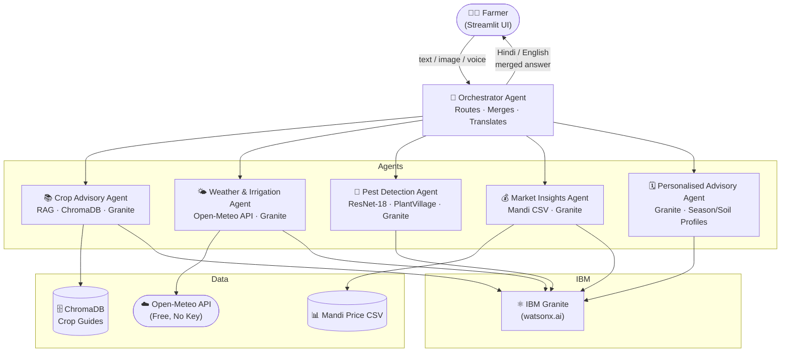

# 🌾 Smart Farming AI Agent

> **IBM Hackathon 2024 Prototype** — Multi-agent AI system for personalised, real-time agricultural advice powered by IBM Granite on watsonx.ai.

---

## 🏗️ Architecture



---

## 📁 Project Structure

```
smart-farming-agent/
├── backend/
│   ├── agents/
│   │   ├── orchestrator.py         ← routes queries, merges answers
│   │   ├── crop_advisory_agent.py  ← RAG + Granite
│   │   ├── weather_agent.py        ← Open-Meteo + irrigation advice
│   │   ├── pest_detection_agent.py ← ResNet-18 + treatment KB
│   │   ├── market_agent.py         ← mandi prices + forecasts
│   │   └── advisory_agent.py       ← personalised season plan
│   ├── models/
│   │   └── schemas.py              ← Pydantic I/O schemas
│   ├── tools/
│   │   ├── granite_client.py       ← watsonx.ai wrapper
│   │   └── translator.py           ← Hindi ↔ English
│   ├── data/
│   │   ├── crop_guides/            ← wheat, rice, tomato guides
│   │   └── mandi/mandi_prices.csv  ← sample price data
│   ├── vectorstore/                ← ChromaDB persistent storage
│   ├── config.py                   ← settings from .env
│   └── main.py                     ← FastAPI app
├── frontend/
│   └── app.py                      ← Streamlit dashboard
├── scripts/
│   └── ingest_docs.py              ← load guides → ChromaDB
├── deployment/
│   ├── Dockerfile.backend
│   ├── Dockerfile.frontend
│   ├── docker-compose.yml
│   └── IBM_CLOUD_DEPLOYMENT.md
├── .env.example
├── requirements.txt
└── README.md
```

---

## ⚡ Quick Start (Local)

### 1. Clone & Install

```bash
git clone https://github.com/your-org/smart-farming-agent.git
cd smart-farming-agent

python -m venv venv
source venv/bin/activate       # Windows: venv\Scripts\activate
pip install -r requirements.txt
```

### 2. Configure Environment

```bash
cp .env.example .env
```

Edit `.env` and fill in:
```
WATSONX_API_KEY=your_ibm_cloud_api_key
WATSONX_PROJECT_ID=your_watsonx_project_id
```

> **No watsonx key?** Set `OFFLINE_MODE=true` — the app runs with stub responses so you can see all UI features.

### 3. Ingest Crop Knowledge Base

```bash
python -m scripts.ingest_docs
# Output: "Ingestion complete. Total chunks: 156 in collection 'farming_knowledge'"
```

### 4. Start the Backend

```bash
uvicorn backend.main:app --reload --port 8000
# API docs: http://localhost:8000/docs
```

### 5. Start the Frontend

```bash
streamlit run frontend/app.py
# Dashboard: http://localhost:8501
```

---

## 🐳 Docker Compose (easiest)

```bash
cp .env.example .env        # fill in your keys
cd deployment
docker-compose up --build
# Backend:  http://localhost:8000
# Frontend: http://localhost:8501
```

---

## 🎬 Demo Script

Follow these steps to showcase all 6 features:

| Step | Action | Feature Shown |
|------|--------|---------------|
| 1 | Open dashboard. Set profile: Ludhiana, Wheat, 5 acres, Alluvial | Farm Profile |
| 2 | Observe 7-day forecast card and irrigation schedule | Weather & Irrigation |
| 3 | Type: *"My wheat leaves have orange-brown pustules"* | RAG Knowledge Base |
| 4 | Upload a leaf photo with visible disease spots | Pest Detection (CNN) |
| 5 | Type: *"When should I sell my wheat?"* | Market Insights |
| 6 | Click 🗓️ Advisory tab or ask: *"Make a full season plan for my farm"* | Personalised Advisory |
| 7 | Switch language to **हिंदी** and repeat question | Multilingual |
| 8 | Click 🎤 voice button and ask a question aloud | Voice Input |

---

## 🤖 Agent Details

| Agent | Input | Technology | Output |
|-------|-------|-----------|--------|
| **Orchestrator** | Any query | Keyword routing + Granite merge | Merged answer |
| **CropAdvisoryAgent** | Text query | ChromaDB RAG + Granite | Answer + citations |
| **WeatherIrrigationAgent** | Lat/lon | Open-Meteo + Granite | Forecast + schedule |
| **PestDetectionAgent** | Leaf image | ResNet-18 (PlantVillage) + Granite | Disease + treatments |
| **MarketInsightsAgent** | Crop name | Mandi CSV + Granite | Price trend + tips |
| **PersonalisedAdvisoryAgent** | Farm profile | Granite | Full season plan |

---

## 🔗 APIs Used

| API | Cost | Docs |
|-----|------|------|
| IBM watsonx.ai (Granite) | Lite tier free | cloud.ibm.com/watsonx |
| Open-Meteo | Free, no key | open-meteo.com |
| AgMarkNet (future) | Free | agmarknet.gov.in |
| Google Translate | Free via deep-translator | — |

---

## ⚠️ Disclaimer

This system provides **AI-generated guidance only** and is intended as a decision-support tool.

- **Chemical/Pesticide Advice**: Always consult a certified agronomist before applying any chemical. Incorrect use can damage crops and harm health.
- **Low-confidence answers** (< 50%): The system will flag these and recommend consulting your local Krishi Vigyan Kendra (KVK).
- **Emergency**: Call Kisan Call Centre **1800-180-1551** (free, 6 AM–10 PM daily).

---

## 🚀 Cloud Deployment

See [`deployment/IBM_CLOUD_DEPLOYMENT.md`](deployment/IBM_CLOUD_DEPLOYMENT.md) for the full step-by-step IBM Cloud + Code Engine deployment guide.

---

## 📜 License

MIT License — Free for educational and hackathon use.

---

*Built with ❤️ using IBM Bob | IBM Granite | watsonx.ai | FastAPI | Streamlit | ChromaDB*
